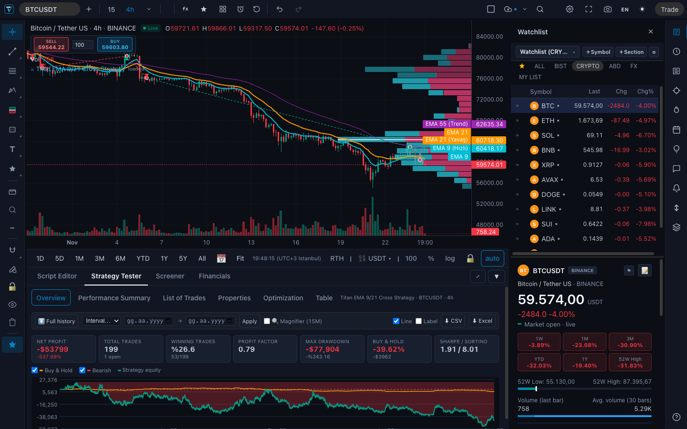
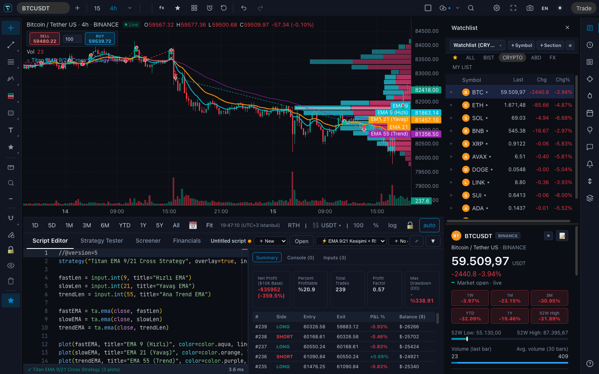
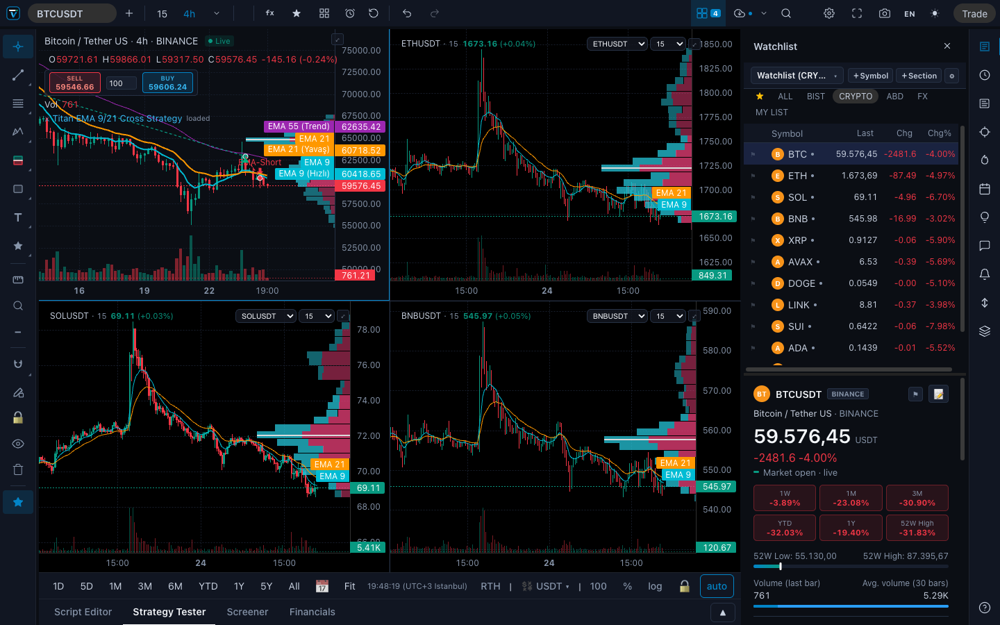
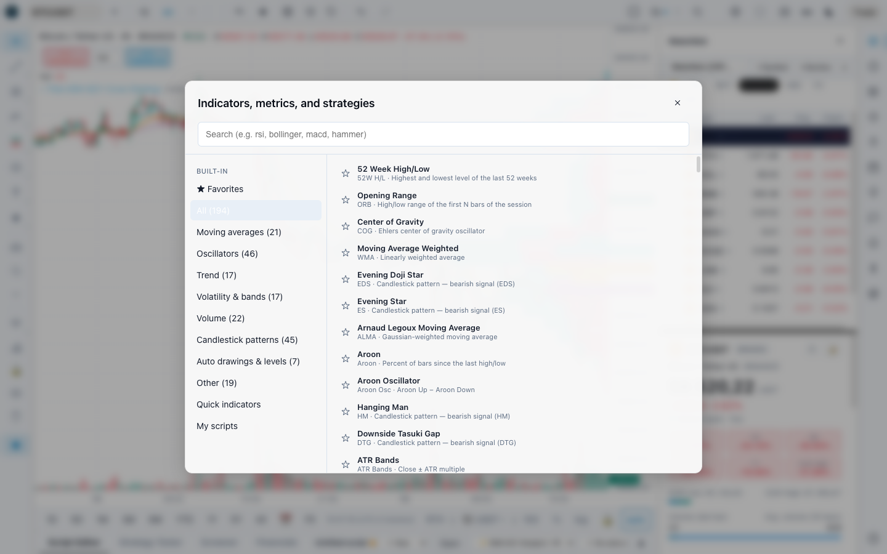
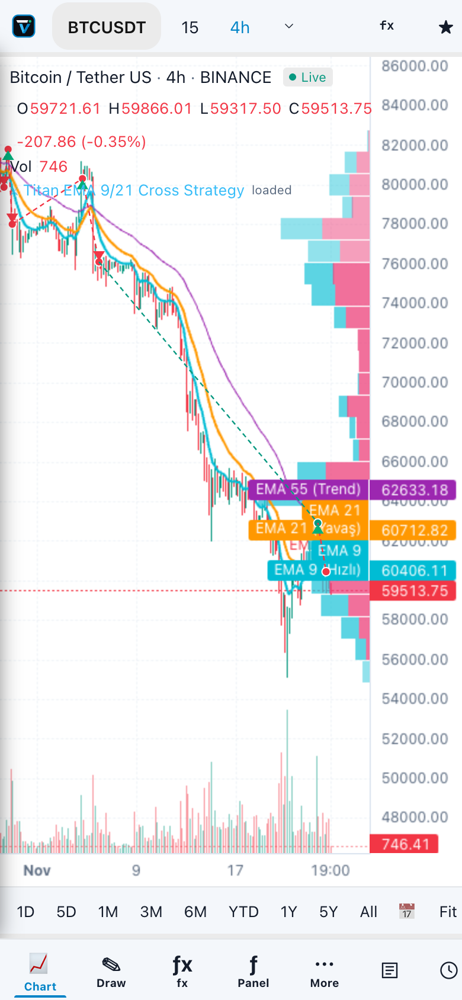

<div align="center">


# TitanView

**An open-source, local-first charting and market analysis terminal with the TitanScript (`.titan`) engine,
a strategy tester, server-side alerts, and paper trading.**

Desktop (macOS · Windows · Linux) · Android · Browser · Your data stays on your machine

[](https://github.com/ersincebi/titanview/actions/workflows/ci.yml)
[](LICENSE)
[](https://github.com/ersincebi/titanview/releases)
[](#download--install)

[Download](https://github.com/ersincebi/titanview/releases/latest) ·
[Screenshots](#screenshots) ·
[Documentation](#documentation) ·
[Build from source](#build-from-source) ·
[Contributing](CONTRIBUTING.md) ·
[Türkçe](#türkçe)

<br />



</div>

> **Not affiliated with TradingView.** TradingView® and Pine Script® are registered trademarks of
> TradingView, Inc. TitanView is an independent project and is not sponsored or endorsed by them. See [NOTICE](NOTICE).

---

## Why TitanView?

Charting platforms keep moving core features behind paywalls: indicator limits, alert limits, intraday
Renko/Kagi, footprint charts, and multi-chart layouts. TitanView is a complete, self-hosted alternative
that anyone can run, inspect, and improve:

- **Local-first.** A Go server with an SQLite WAL cache runs next to the UI. No account, no cloud, no tracking.
- **Ergonomic.** Keyboard-driven workspace, fast shortcuts, 42 multi-chart layouts (up to 16 panes), dark & light themes, English & Turkish UI.
- **Programmable.** Real bar-by-bar **TitanScript** (`.titan`) runtime supporting `//@version=5/6`, `indicator()`, `strategy()`, and `library()`, accelerated with Rust/WASM. Compatible scripts from other charting platforms run with little or no modification.
- **Privacy & compliance first.** Official public APIs (Binance, Deribit, central-bank calendars) work out of the box; unofficial third-party endpoints are **off by default** behind an explicit opt-in consent gate.
- **Hackable.** TypeScript + SolidJS front end, Go back end, Rust/WASM hot core, Tauri v2 desktop & Android shell. All tested (`go test -race`, 1,100+ UI/engine tests, smoke suite, license & secret CI gates).

---

## Screenshots

<table>
  <tr>
    <td width="50%">
      <strong>TitanScript Monaco Editor & Live Strategy Summary</strong><br />
      
    </td>
    <td width="50%">
      <strong>2×2 Multi-Chart Sync Layout (Up to 16 Charts)</strong><br />
      
    </td>
  </tr>
  <tr>
    <td width="50%">
      <strong>194 Clean-Room Built-In Indicators & Light Theme</strong><br />
      
    </td>
    <td width="50%" align="center">
      <strong>Mobile & Android Responsive View</strong><br />
      
    </td>
  </tr>
</table>

---

## Features

| Area | What you get |
|---|---|
| **Charts** | 21 chart types: bars, candles, hollow & volume candles, line/step/area/HLC area/baseline, columns, high-low, Heikin Ashi, Renko, line break, Kagi, Point & Figure, range, **volume footprint** (real order flow for crypto), **TPO**, **session & visible volume profile** |
| **TitanScript engine** | Bar-by-bar `.titan` runtime: `var`/`varip`, UDTs, methods, enums, `map`, `matrix`, libraries (`import`/`export`), non-repainting `request.security`, drawings (`line`, `box`, `label`, `table`, `polyline`, `linefill`), `log.*` console; compatible syntax with scripts from other platforms |
| **Script editor** | Monaco-based TitanScript editor with syntax highlighting, autocomplete, signature help, hover docs, error markers, script library, and version history |
| **Indicators** | **194 clean-room built-in indicators** written in TitanScript (`.titan`), 45 candlestick patterns, auto Fib/pivots/trendlines, indicator-on-indicator, visible/fixed/session volume profiles |
| **Drawing tools** | Lines, channels, pitchforks, full Fibonacci & Gann families, shapes, XABCD/harmonic patterns, Elliott waves, forecasting & measuring tools, notes, icons, templates, magnet modes |
| **Strategy tester** | Realistic bar-by-bar broker emulation, deep backtest over full history, bar magnifier, trade list linked to chart, CSV/XLSX export, parameter optimization (grid search on parallel WASM workers) |
| **Alerts** | Server-side engine that keeps running when the UI is closed: price, indicator, strategy, and drawing conditions; webhook, Telegram, ntfy push, and Web Push |
| **Layouts** | 42 layouts (1–16 charts) with symbol, interval, crosshair, time, and drawing sync; saved & shareable read-only layouts; custom intervals (including seconds for crypto) |
| **Symbols & data** | Symbol expressions (`BTCUSDT/ETHUSDT`, spreads, baskets), currency conversion, dividends/splits/earnings on chart, fundamentals, official economic calendars, crypto options (Deribit) |
| **Watchlists & screeners** | Multiple & 7-color flagged watchlists, custom columns, import/export, advanced screener, and **TitanScript screener** |
| **Trading** | Paper trading with all order types and draggable orders/TP/SL on chart; opt-in live orders on Binance (your own keys, encrypted locally, explicit confirmation per order) |
| **Extras** | Command bar (`DES`, `GP`, `FA`, `OVME`), market heatmap, correlation matrix, multi-factor analysis panel, whale tape, offline mode, English & Turkish UI |

---

## Download & Install

Grab the package for your platform from **[GitHub Releases](https://github.com/ersincebi/titanview/releases/latest)**:

| Platform | Package | Install notes |
|---|---|---|
| **macOS** (Apple Silicon & Intel) | `.dmg` | Drag to Applications, or install via Homebrew below |
| **Windows 10/11** | `.exe` installer or `.msi` | Per-user NSIS / WiX installer |
| **Linux** | `.AppImage`, `.deb`, `.rpm` | Standalone AppImage or system package |
| **Android 7+** | `.apk` | Download from Releases; allows local in-process core or remote server ([docs/mobile.md](docs/mobile.md)) |
| **Self-hosted Web** | Docker Compose | `docker compose up -d --build` (listens on `127.0.0.1:8098`) |

**macOS with Homebrew:**

```bash
brew tap ersincebi/titanview https://github.com/ersincebi/titanview
brew install --cask titanview
```

> Release builds are not yet signed with paid Apple Developer or Windows Authenticode certificates.
> macOS Gatekeeper and Windows SmartScreen may show a first-launch warning. Code signing is on the [roadmap](#roadmap).

---

## Documentation

| Guide | Topics |
|---|---|
| **[Getting Started](docs/getting-started.md)** | Installation, official vs. opt-in data sources, remote server pairing, shortcuts, paper/live trading |
| **[TitanScript Guide](docs/titanscript.md)** | `.titan` language features, `ta.*`, strategy backtesting, examples, adding clean-room indicators |
| **[Architecture & Security](docs/architecture.md)** | System diagram, package map, SQLite WAL cache, token auth, transport opt-in gate, CI compliance |
| **[Desktop App](docs/desktop.md)** | Tauri v2 sidecar architecture, data directories, tray menu, auto-updater, building desktop bundles |
| **[Android App](docs/mobile.md)** | Local in-process Go core (`libtitan.so`), `-remote` server pairing, `ntfy` phone push notifications |
| **[Contributing](CONTRIBUTING.md)** & **[Security](SECURITY.md)** | Clean-room rules, DCO sign-off, test commands, vulnerability reporting |

---

## Build from source

**Requirements:** Node.js 20+ and pnpm 10, Go 1.26+, Rust stable (for the WASM core and Tauri shell).

```bash
git clone https://github.com/ersincebi/titanview.git
cd titanview
pnpm install

# Web: build the UI and start the local server
make build
./backend/titanview-server --port 8080 --db data/titanview.db --static dist
# open http://localhost:8080

# Frontend dev server with hot reload (needs the Go server on :8080)
pnpm dev

# Desktop app (Tauri v2)
pnpm desktop:build

# Android APK (needs Android SDK + NDK; see docs/mobile.md)
node scripts/android-init.mjs
pnpm tauri android build --apk
```

Run the full local verification suite:

```bash
make verify                                          # Go -race, typecheck, frontend tests, build, smoke
node scripts/check-licenses.mjs --require-go --require-rust  # License & clean-room audit
```

---

## Roadmap

| Status | Item |
|---|---|
| ✅ | Charts, TitanScript engine & editor, 194 clean-room indicators, drawing tools, strategy tester, alerts, layouts, watchlists, paper trading |
| ✅ | Desktop packages for macOS / Windows / Linux (Tauri v2), Homebrew cask, signed auto-updater manifest |
| ✅ | Android app (local in-process Go core or remote server), phone push via `ntfy` |
| ✅ | Opt-in gate for unofficial data sources, automated cross-ecosystem license & `gitleaks` CI compliance |
| 📋 | Pluggable market-data provider SDK, notarized macOS & Authenticode Windows builds, additional UI languages |

Ideas, bug reports, and PRs are welcome! Browse [good first issues](https://github.com/ersincebi/titanview/labels/good%20first%20issue), join [Discussions](https://github.com/ersincebi/titanview/discussions), or read [CONTRIBUTING.md](CONTRIBUTING.md).

---

## Disclaimer

- **Not financial advice.** TitanView is a charting and research tool. Signals, analysis, backtests, and
  paper results are not investment advice. Trading carries risk of loss; you alone are responsible for your decisions.
- **Market data.** TitanView does not provide or redistribute market data. It connects directly from your machine:
  - **Official public APIs (enabled by default):** Binance (spot candles, live WebSocket, order-flow footprint), Deribit (crypto options), and official statistical/central-bank calendars (TCMB, TÜİK, Fed, BLS, ECB, BEA, SPK).
  - **Unofficial endpoints (disabled by default — opt-in):** Yahoo Finance, Google News, and İş Yatırım (used for BIST/US equities, FX conversion, fundamentals, corporate events, and news) are **OFF by default** and no requests are sent to them until you explicitly review and accept responsibility for third-party terms of use in **Settings → Data sources** (or set `TITAN_UNOFFICIAL_SOURCES=1` / `-unofficial-sources` on headless servers). BIST data is ~15 minutes delayed.
- **Live orders** are opt-in, use your own API keys, and require explicit confirmation for each order. Use at your own risk.
- The software is provided "as is", without warranty of any kind (AGPL-3.0, sections 15 and 16).

## License

TitanView is free software under the **GNU Affero General Public License v3.0 or later** ([LICENSE](LICENSE)).
You may use, study, modify, and share it. If you distribute it, or run a modified version as a network service,
you must make your source code available under the same license. Third-party notices: [NOTICE](NOTICE).

---

## Türkçe

TitanView; **TitanScript** (`.titan`) betik motoru, strateji test cihazı, sunucu tarafı alarmları ve
paper trading'i olan **açık kaynak, yerel öncelikli** bir grafik ve analiz terminalidir. Masaüstünde
(macOS / Windows / Linux), Android'de ya da tarayıcıda çalışır; veriler senin bilgisayarında, SQLite'ta durur.

- **İndir ve Kur:** [Releases](https://github.com/ersincebi/titanview/releases/latest) sayfasından platformuna uygun paketi indir
  (`.dmg`, `.exe` / `.msi`, `.AppImage` / `.deb` / `.rpm`, Android için `.apk`). macOS'ta Homebrew ile: `brew tap ersincebi/titanview https://github.com/ersincebi/titanview && brew install --cask titanview`.
- **Dokümantasyon:** [Başlangıç Rehberi](docs/getting-started.md) · [TitanScript Rehberi](docs/titanscript.md) · [Mimari](docs/architecture.md) · [Masaüstü](docs/desktop.md) · [Android](docs/mobile.md).
- **Betik uyumluluğu:** Başka platformlardan gelen uyumlu söz dizimindeki betikler (`//@version=5/6`, `indicator()`, `strategy()`, `library()`) az değişiklikle ya da hiç değişiklik yapmadan çalışır.
- **Veri:** TitanView veri dağıtmaz; üçüncü tarafların uç noktalarına senin bilgisayarından bağlanır.
  Resmî açık API'ler (Binance, Deribit, TCMB/TÜİK/Fed/BLS/ECB takvimleri) varsayılan açıktır. Resmî olmayan
  üçüncü taraf uç noktaları (Yahoo Finance, Google News, İş Yatırım — BIST/ABD hisseleri, kurlar, temel veriler,
  haberler) **varsayılan olarak kapalıdır**; **Ayarlar → Veri Kaynakları** üzerinden kullanım şartları
  sorumluluğunu onaylayarak (veya sunucuda `TITAN_UNOFFICIAL_SOURCES=1` ile) açılabilir. BIST verisi ~15 dk gecikmelidir.
- **Katkı ve Tartışma:** [CONTRIBUTING.md](CONTRIBUTING.md), [good first issues](https://github.com/ersincebi/titanview/labels/good%20first%20issue) ve [Discussions](https://github.com/ersincebi/titanview/discussions).
- **Bağımsızlık bildirimi:** TitanView'ın TradingView ile bağlantısı yoktur. TradingView® ve Pine Script®, TradingView, Inc.'in tescilli markalarıdır; bkz. [NOTICE](NOTICE).
- **Yatırım tavsiyesi değildir.** Gösterilen sinyal, analiz ve backtest sonuçları yatırım tavsiyesi değildir.
- **Lisans:** AGPL-3.0 veya sonrası.
