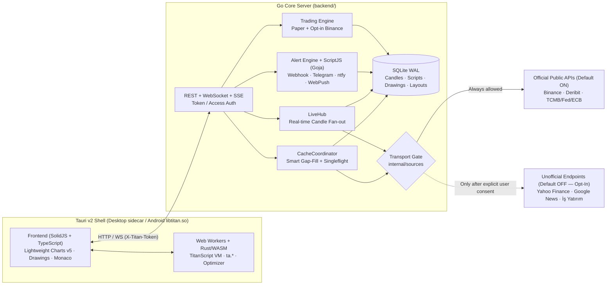

# TitanView Architecture

TitanView is a **local-first** charting and market analysis platform composed of four tightly tested layers: a **SolidJS + TypeScript** frontend, a **Go** core server with **SQLite WAL** storage, a **Rust → WASM** hot-path math core, and a **Tauri v2** native shell for macOS, Windows, Linux, and Android.

---

## High-Level System Diagram

---

## Repository Layout

| Directory | Responsibility |
|---|---|
| `frontend/src/chart/` | `ChartController`, multi-pane manager, custom series (Renko, Kagi, P&F, Line Break, Range, Volume Footprint, TPO, Volume Profile), 80+ drawing tools |
| `frontend/src/script/` | Complete TitanScript engine: lexer, recursive-descent parser, static type checker, bar-by-bar VM, `ta.*` library, broker emulator, incremental session cache, Monaco language provider, 194 clean-room built-ins (`builtins/*.titan`) |
| `frontend/src/state/` | SolidJS reactive stores, multi-chart layouts (42 templates, 1–16 panes), workspace persistence, i18n (`tr` / `en`), theme engine, strategy optimizer |
| `frontend/src/ui/` | Modular terminal UI (TopBar, LeftBar, ChartArea, Drawer, Workbench, Modals, Settings, TradePanel, AlertDialog, Fundamentals, Calendar, Options, Screener) |
| `frontend/src/desktop/` | Tauri shell bridge (`bridge.ts`) and remote server pairing (`remote.ts`) |
| `wasm/titan-core/` | Zero-dependency Rust crate compiled to WebAssembly (`titanCoreWasm.ts`) for hot-path incremental `ta.*` calculations |
| `backend/internal/app/` | Unified server assembler shared by `cmd/server` (web/desktop/remote) and `backend/mobile` (Android `libtitan.so`) |
| `backend/internal/sources/` | Concurrency-safe HTTP `RoundTripper` opt-in gate blocking unofficial third-party hosts by default |
| `backend/internal/provider/` | Market data fetchers (`Binance`, `Deribit`, official calendars, opt-in `Yahoo`/`Google News`/`İş Yatırım`), expression evaluator, whale tape |
| `backend/internal/normalizer/` | Strict OHLCV normalization, resampling, and fuzz-tested candle validation |
| `backend/internal/storage/` | SQLite WAL store: candles, fetched-range gap tracking, scripts & version history, drawings, layouts, watchlists, notes, screener presets, app settings |
| `backend/internal/alerts/` | Server-side alert evaluator (price, indicator, strategy, drawing conditions) + Webhook/Telegram/ntfy/WebPush notifier |
| `backend/internal/scriptjs/` | Goja-hosted server-side TitanScript runner for background alerts and Script Screener |
| `backend/internal/trading/` | Paper trading broker + opt-in Binance spot client with AES-GCM encrypted key storage (`0600` master key) |
| `backend/internal/footprint/` | Real-time order-flow volume footprint aggregation from Binance `aggTrades` |
| `backend/internal/analytics/` | Multi-factor technical scoring, correlation matrix, market overview, symbol insights |
| `src-tauri/` | Tauri v2 shell: sidecar lifecycle (`sidecar.rs`), Android JNI/C-ABI loader (`core.rs`), tray/notifications/shortcuts/updater (`lib.rs`, `alerts.rs`) |

---

## Security & Privacy Model

- **Local loopback isolation:** Desktop sidecar and Android in-process core bind exclusively to `127.0.0.1:0` (ephemeral loopback port) and require a per-launch 256-bit random `X-Titan-Token` plus strict Tauri origin CORS checks.
- **Remote server mode (`-remote`):** Enforces a persistent high-entropy token (`0600` file or `TITAN_REMOTE_TOKEN`), supports pairing URIs (`titanview://pair?...`), browser login cookies (`HttpOnly`, `SameSite=Lax`), and optional **Cloudflare Access** JWT verification (`CF_ACCESS_TEAM` + `CF_ACCESS_AUD`).
- **Encrypted API keys:** Optional Binance live trading keys are encrypted at rest in SQLite using a locally generated key (`0600`). Live order execution requires a two-step preview + explicit confirmation token on every order.
- **Opt-in network boundary:** `internal/sources` wraps `http.DefaultTransport` at startup so unofficial third-party domains (`yahoo.com`, `news.google.com`, `isyatirim.com.tr`) are rejected with HTTP `403` (`unofficial_sources_disabled`) unless explicitly enabled in **Settings → Data sources** or via `TITAN_UNOFFICIAL_SOURCES=1`.
- **Automated compliance CI:** Every commit runs `go test -race`, fuzzing, 1,100+ frontend unit/UI tests with coverage thresholds, end-to-end smoke tests (`scripts/smoke.sh`), full cross-ecosystem license & clean-room verification (`scripts/check-licenses.mjs`), and `gitleaks` secret scanning.
